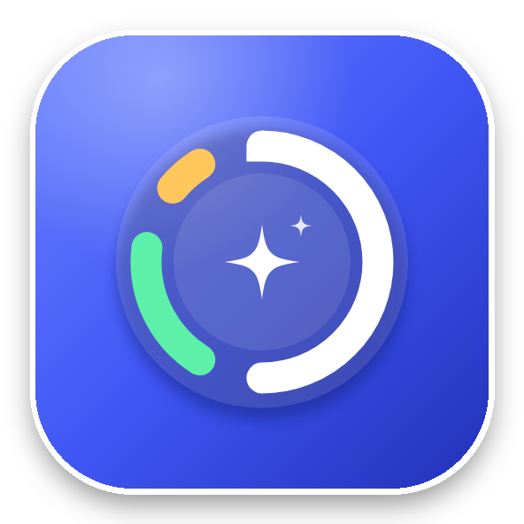

# Merhaba, ben Ezgi 👋 | Hi, I'm Ezgi 👋

**Kıdemli Java Geliştirici · Teknik Liderlik ve Legacy Modernizasyonu 🚀**
**Senior Java Developer · Technical Leadership & Legacy Modernization 🚀**

---

## 🇹🇷 Türkçe

Mainframe'den mikroservis mimarisine geçişlerde modül düzeyinde teknik liderlik yapan, yüksek trafikli ve regülasyona tabi sistemlerde çalışan bir Java geliştiricisiyim ☕. Tasarım kararları, API sözleşmeleri, performans optimizasyonu ve mentorlukle ilgileniyorum 🧑‍🏫.

### 🚀 Öne Çıkanlar

- 🏦 Mainframe tabanlı kredi kartı platformunun **40 modülünü** Java / Spring Boot mikroservis mimarisine taşıdım.
- ⚡ Günde yaklaşık **100 milyon çağrı** alan servislerde ortalama yanıt süresini **200 ms'den 20 ms'ye** düşürdüm.
- 💰 Taşınan servislerle mainframe'de günlük yaklaşık **5 saatlik CPU süresi** tasarrufu sağladım.
- 🔐 Statik kod analiziyle yeniden yazılan modüllerdeki yaklaşık **20 güvenlik açığını** tespit edip giderdim.
- 🧑‍🏫 7 kişilik ekipte teknik yönlendirme ve kod incelemesi yaptım, ekip arkadaşlarıma mentorluk ettim.

### 📌 Deneyim

- 💳 **Kıdemli Java Yazılım Geliştirici · Garanti BBVA Teknoloji / OBSS** (2023 – 2026): Core Banking, kredi kartı ürünleri
- 🛒 **Full Stack / Backend Geliştirici · ETSTUR** (2021 – 2023): Muhasebe ve ödeme sistemleri, B2C hotel rent a car transfer platformları, REST / SOAP entegrasyonları
- 🎓 **Bilgisayar Mühendisliği Lisansı** · Akdeniz Üniversitesi (İngilizce eğitim programı), 2015 – 2020

### 🌍 Diller

🇹🇷 Türkçe (ana dil) · 🇬🇧 İngilizce (C1, YÖKDİL 86)

### 🎯 Şu An

🔎 Yeni bir senior Java geliştirici veya teknik liderlik rolü arıyorum. Modernizasyon, mikroservis mimarisi ve performans odaklı projelerle ilgileniyorum.

---

## 🇬🇧 English

I'm a Java developer who leads at the module level in mainframe-to-microservices migrations, working on high-traffic and regulated systems ☕. I focus on design decisions, API contracts, performance optimization and mentoring 🧑‍🏫.

### 🚀 Highlights

- 🏦 Migrated **40 modules** of a mainframe-based credit card platform to a Java / Spring Boot microservices architecture.
- ⚡ Reduced average response time from **200 ms to 20 ms** on services handling roughly **100 million calls per day**.
- 💰 Saved roughly **5 hours of daily mainframe CPU time** by moving services to Java.
- 🔐 Found and fixed around **20 security vulnerabilities** in rewritten modules through static code analysis.
- 🧑‍🏫 Led technical direction and code reviews for a 7-person team, and mentored teammates through the mainframe-to-Java transition.

### 📌 Experience

- 💳 **Senior Java Software Developer · Garanti BBVA Technology / OBSS** (2023 – 2026): Core Banking, credit card products
- 🛒 **Full Stack / Backend Developer · ETSTUR** (2021 – 2023): Accounting and payment systems, B2C hotel, rent a car and transfer platforms, REST / SOAP integrations
- 🎓 **B.Sc. Computer Engineering** · Akdeniz University (English-medium program), 2015 – 2020

### 🌍 Languages

🇹🇷 Turkish (native) · 🇬🇧 English (C1, YÖKDİL 86)

### 🎯 Currently

🔎 Looking for a new senior Java developer or technical leadership role. I'm interested in modernization, microservices architecture and performance-focused projects.

---

## 📱 Projeler | Projects

  

<h3 align="center">PlateMetric AI</h3>

 

🇹🇷 Yemek fotoğraflarından kalori ve makro besin değerlerini yapay zekâyla hesaplayan mobil uygulama 📸. Yemeğinin fotoğrafını çek, yemekleri, gramajlarını ve kalorilerini öğren. Diyet listesi ekleme, günlük takip, kalori harcama hesaplama, su takibi, alerji uyarıları ve öğün hatırlatıcıları da içeriyor ⏰.
🇬🇧 A mobile app that uses AI to estimate calories and macronutrients from photos of your meals 📸. Snap a photo of your plate to get the dishes, portion weights and calories. It also includes adding diet lists, daily tracking, calorie burn calculation, water tracking, allergy alerts and meal reminders ⏰.
🧪 Currently in Google Play closed testing | Şu anda Google Play kapalı test aşamasında.

---

## 🛠️ Tech Stack

**Languages:**    

**Backend:**   

**Frontend:**    

**Databases & Cache:**   

**DevOps & Cloud:**     

**Testing & Quality:**   

**AI-Assisted Development:** 

---

## 📫 Connect | İletişim

📍 Antalya, Türkiye

---

✨ Thanks for stopping by! Teşekkürler, uğradığın için! 🙌
